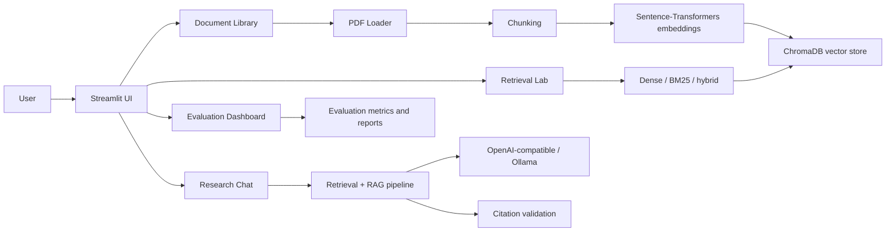

# Architecture

## Component notes
- The PDF loader extracts page-level text and preserves page numbers.
- The chunker creates overlapping text units with stable chunk IDs.
- The embedding manager stores vectors in persistent ChromaDB collections.
- Retrieval combines dense semantic matching and BM25 keyword evidence.
- The RAG layer prompts the LLM with retrieved passages and validates citations.
